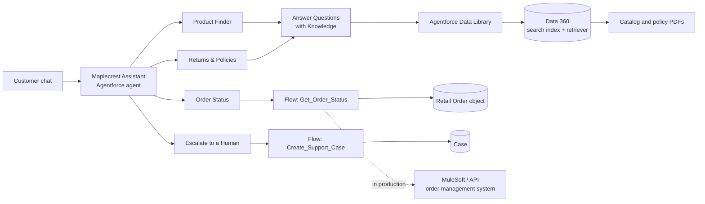

# Maplecrest Assistant: an Agentforce customer service agent

A working Agentforce agent for a fictional multi-brand retailer, built to show how I take an AI agent from business goal to a tested, production-ready deployment.

> **All company names, products, customers and orders in this project are fictional.** Maplecrest Retail Group, Maplecrest Auto, Boreal Sport and Ironpine Workwear do not exist. No real customer data is used.

## The business problem

Maplecrest Retail Group runs three brands with different catalogs and policies:

| Brand | Sells | Policy differences |
|---|---|---|
| Maplecrest Auto | Tires, batteries, auto parts | 30-day returns; installed tires non-returnable; battery core charge |
| Boreal Sport | Hockey, running, cycling, camping, skiing | 60-day returns; baked skates 14 days; mounted skis final sale |
| Ironpine Workwear | Safety boots, work apparel | 90-day returns; worn boots non-returnable; 1-year boot warranty |

Customer care handles the same questions every day: *Which tire fits my car? Where is my order? Can I return this?* Answers vary by brand, and agents switch between systems to find them.

**Goal:** resolve the most common questions in chat, accurately and safely, and hand everything else to a person with a clear summary.

## What the agent does

| Topic | What it handles | How it works |
|---|---|---|
| Product Finder | Product advice, sizing, specs, prices | Retrieval (RAG) over brand catalogs and buying guides in an Agentforce Data Library |
| Order Status | Status, tracking, delivery date, pickup | Flow action that matches on order number **and** email |
| Returns & Policies | Returns, shipping, price match, services | Retrieval over the policy document, answered per brand |
| Escalate to a Human | Damaged items, complaints, privacy requests | Flow action that creates a Case with an AI-written summary |

## Architecture

All model calls run through the Einstein Trust Layer.

## Design decisions

- **Grounded answers only.** Product and policy answers come from the Data Library. The instructions forbid inventing products, prices or specs, and the test set includes out-of-catalog questions to check it.
- **Ask before acting.** The agent asks one clarifying question when it needs it (tire size, start-stop vehicle, player weight, job-site requirements) instead of guessing.
- **Privacy by design.** An order lookup needs both the order number and the email. If they don't match, the agent reveals nothing.
- **Brand-aware policies.** Policies differ by brand, so the agent names the brand whose policy applies and asks when it's unclear.
- **Built-in escalation.** Complaints, damaged products and privacy requests go to a person with a case summary, so the agent never tries to handle what it shouldn't.
- **Production path.** Order data lives in a custom object for the demo. In production, the same Flow action would call the order management system through MuleSoft or an API, without changing the agent.

## Testing

The agent is evaluated in Agentforce Testing Center with 20 test conversations (`data/maplecrest_test_cases.csv`), covering every topic plus edge cases: an out-of-catalog product, an order that doesn't exist, a missing order number, and a prompt-injection attempt asking for a discount code.

Results and the fixes made between runs are in [`docs/test-results.md`](docs/test-results.md).

## Rollout

How I'd take this from demo to production across three brands, with phases, go/no-go criteria, risks and rollback: [`docs/rollout-plan.md`](docs/rollout-plan.md).

## From demo to production

[`docs/production-architecture.png`](docs/production-architecture.png) shows what changes for a real customer: the agent stays the same, while knowledge moves to Data Cloud, the order lookup calls the order management system through a Named Credential or MuleSoft, and hand-offs route through Omni-Channel. Releases go through Git and the Testing Center suite.

## Running the POC

How I'd run this as a customer POC, shown with the three forms I use, filled in with synthetic data for this demo: [`docs/poc-record-example.pdf`](docs/poc-record-example.pdf).

| Form | What it shows |
|---|---|
| POC Kickoff | Business goals, stakeholders with committed hours, use cases scored and chosen, success criteria with baselines, timeline, kickoff conditions |
| Weekly Checkup (week 5) | Milestones against forecast, success criteria progress, test results by agent version, roadblocks, resource gaps, early warning check |
| Change Request (CR-003) | One fix from feedback to verified change, plus the change log. CR-001 to CR-005 are the real fixes from the Testing Center runs above |

People, dates and business figures in the record are fictional. The test results and fixes are real.

## Repository contents

| Path | What's there |
|---|---|
| `data/` | Sample orders, catalog and policy PDFs, test cases, product list |
| `agent/` | The full agent definition in Agent Script, exported from Agentforce Builder, and the Flow specs |
| `docs/` | Rollout plan, test results and the POC record |

## Built with

Agentforce (Agent Builder, topics, actions, Testing Center), Agentforce Data Library on Data 360, Salesforce Flow, Einstein Trust Layer, Salesforce Developer Edition.

## About

Built by Leo Herrera ([@leo-herrera-27](https://github.com/leo-herrera-27)).
